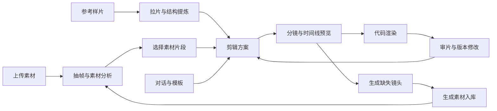

# 通用视频 AI 剪辑工作台：产品方案与接入核对

> **历史方案，已由后续定位与实现替代。** 本文保留 2026-10-20 开发前记录，不是当前需求或状态；下文“尚未开发”、五入口、对话首页和待确认问题均只描述当时。当前项目名 AHB，优先面向品牌总部内容运营。协作请从 [README](../README.md)、[产品设计](../docs/design.md) 与 [协作说明](../CONTRIBUTING.md) 开始。原有调研内容与来源未改写。

日期：2026-10-20。状态：前置调研完成，产品边界待确认；尚未开发、接入付费调用或部署。

## 已确认需求

1. 通用剪辑入口以对话框为主，下方展示剪辑模板。剪辑全部由代码完成，不使用 Computer Use 操作剪辑软件。
2. 上传图片、视频到素材库，调用 DeepSeek 打标；视频按长度抽帧，分析输出 JSON。
3. 素材分析页展示标签与内容，允许自选素材组合，生成剪片建议和可视化剪辑结构。
4. 参考样片页提供拉片分析与“一键洗稿”，研究 OpenMontage、reelbench-skills。
5. 接入已有 MiniMax H3，接入其官方 Skills，借鉴 AI 短剧流程。
6. 视觉参考 Hermes Agent 官网：蓝色、有字体设计、极简。

## 建议的产品整体

五个入口共用项目、素材和版本。一份带时间码的剪辑方案同时驱动结构图、预览与渲染，避免分析报告和成片脱节。

| 入口 | 主要操作 | 产物与下游 |
|---|---|---|
| 开始剪辑 | 对话输入目标，附素材，选模板、比例、时长 | 创建同一项目的剪辑方案；模板锁定版本 |
| 素材库 | 上传、预览、检索、按项目选择 | 永久原件、缩略图、片段引用；分析状态单独显示 |
| 素材分析 | 看标签与内容，点开证据帧，选择整片或时间区间 | 剪辑建议、缺失镜头、可继续调整的分镜与时间线 |
| 参考样片 | 上传样片，分析切点、叙事、画面与声音 | 拉片报告；改编能力的最终交付范围待确认 |
| AI 素材生成 | 选模式/风格，给角色和场景参考，逐镜头生成 | 带来源与生成版本的素材，回到同一个素材库和项目 |

结构图建议同时提供“叙事分段”和“视频/字幕/声音轨道”，显示每段时长及真实素材缩略图。点镜头能定位源素材区间，替换镜头后同步更新计划；缺素材必须显式呈现，不用虚构素材占位冒充可渲染状态。

## 已核实的供应商能力

### DeepSeek

- 当前官方视觉模型为 `deepseek-flash`，接受图片；可按用户要求先在本地对视频抽帧，再送图分析。官方当前图片接口不能等同原生视频或音轨理解。
- Responses API 提供 JSON Schema 输出；Chat Completions 的 `json_object` 只保证 JSON 模式。结果仍须本地验证字段、枚举和时间范围。
- 建议按时长进行基础采样，并在镜头变化位置补帧。具体采样阈值待真实长短视频验证，不提前假定统一间隔足够。
- 分开保存文件级摘要/标签与片段级内容：`asset_id`、起止时间、证据帧时间、画面内容、景别/运镜、可剪用途、分析模型/版本和人工修订。没有分析到音频时明确标记，不能从画面推断台词。

来源：[视觉接口](https://api-docs.deepseek.com/guides/vision/) · [Responses 接口](https://api-docs.deepseek.com/api/create-response/) · [JSON 模式](https://api-docs.deepseek.com/guides/json_mode/)。

### MiniMax H3 与官方 Skills

- H3 官方生成接口为 `POST /v2/video_generation`，模型 `MiniMax-H3`，支持文字、首帧、尾帧、首尾帧及多模态参考；通过供应商任务 ID 查询结果。
- 当前星尚接的是固定主持人的 Ref2VA 口播流程；通用视频生成需要重新设计输入与分镜，不能把现有口播接口直接视作完成。
- 官方 H3 仓库包含 9 个 Skills：提示词写作、极简产品广告、3D 动画短片、纸艺定格解说、品牌宣传、音乐视频字幕、合作游戏开场、纸张拼贴解说、手绘实拍混合。
- `h3-prompt-writing` 可直接跨 Agent 使用；其余 8 个依赖 MiniMax Hub 的画布、选择卡及图像/视频工具，需要把创作流程适配为本工作台的素材、分镜和生成任务。部分流程需要生图和音频能力，单独 H3 视频接口并不覆盖所有依赖。
- 本项目“官方 Skills”建议按 H3 仓库这 9 个理解；MiniMax 通用开发/文档 Skills 是另一套范围。
- 生成任务必须保存供应商 ID、输入、提示词和版本；提交结果未知时先核对原请求，避免重复生成。批量镜头应显示数量、时长、预计费用并支持单镜头重做。

来源：[H3 仓库与兼容性说明](https://github.com/MiniMax-AI/MiniMax-H3) · [生成 API](https://platform.minimax.io/docs/api-reference/video-generation-v2-create) · [Skills 目录](https://github.com/MiniMax-AI/MiniMax-H3/blob/main/skills/README.md) · [官方 CLI 执行 Skill](https://github.com/MiniMax-AI/cli/blob/main/skill/h3-video/SKILL.md)。

## 参考项目的取舍

- **OpenMontage**：参考分析、创意提案、生产的分层方式；不把整个仓库直接当成可靠的一键改编接口。新项目应明确分析失败和缺少音轨信息，避免不完整结果仍显示完成。
- **ReelBench Skills**：参考切点/关键帧提取、镜头表、交互式报告；它主要做拉片，没有 ASR，也不负责按分析结果重新剪片。其 `video-sync` 是原片与镜头表同步展示，不是改编成片。
- **AI 短剧**：优先借鉴 H3 官方 3D 短片工作流里的角色卡、场景卡、镜头连续性、分镜确认、逐镜头生成与局部重做。通用工作台不必预先加入整套剧集管理。

另核对了 [Huobao Drama](https://github.com/chatfire-AI/huobao-drama) 和 [Toonflow](https://github.com/HBAI-Ltd/Toonflow-app)：前者将角色、场景、道具作为独立资产，由分镜引用；后者通过素材节点连接生成节点，并按模型能力显示参数。适合继承的产品经验是锁定角色/场景参考、单镜头保留多版、选定版本回填时间线。素材入库按时长覆盖采样，参考片拉片则优先逐镜头覆盖，两类分析不能共用同一粗采样策略。

若后续复用源码再按各自许可评估：OpenMontage 为 AGPLv3，ReelBench 为 Apache-2.0，Huobao 为 CC BY-NC-SA 4.0，Toonflow 为 MIT；当前仅研究流程，没有复制源码。[OpenMontage 许可](https://github.com/calesthio/OpenMontage/blob/main/LICENSE) · [ReelBench 许可](https://github.com/eternityspring/reelbench-skills/blob/main/LICENSE) · [Huobao 许可](https://github.com/chatfire-AI/huobao-drama/blob/master/LICENSE) · [Toonflow 许可](https://github.com/HBAI-Ltd/Toonflow-app/blob/master/LICENSE)

来源：[OpenMontage](https://github.com/calesthio/OpenMontage) · [ReelBench Skills](https://github.com/eternityspring/reelbench-skills) · [H3 官方短片流程](https://github.com/MiniMax-AI/MiniMax-H3/blob/main/skills/3d-animation-short-generator/SKILL.md)。以上是基于源码/文档的调研，尚未安装或运行这些项目。

## 从星尚保留的经验

1. **身份与显示名称分开**：项目 ID、作品标题、模板 ID/版本、方案版本、源素材引用单独保存。更改标题不应改变工程身份。
2. **一轮一份冻结方案**：新要求接续项目，旧成片和旧配置保留；结构图、渲染脚本与输出对应同一版本。
3. **原件和缓存分开**：长期素材库原件不套用临时任务文件的清理周期；抽帧和代理视频可以重建。
4. **阶段与执行状态分开**：初稿/修改中/完成不随排队或重试跳动。未知付费提交、上传完成、渲染完成分别核验。
5. **完成由真实文件证明**：解码、时长、尺寸、音轨和版本关联核验通过，才显示可交付；画面质量仍需审片。

本地依据：[`production.py`](../../../9月/AI剪辑工作台/production.py)、[`library.py`](../../../9月/AI剪辑工作台/library.py)、[程序渲染统一入口](../../../9月/AI剪辑工作台/docs/程序渲染统一入口.md)、[任务与版本规则](../../../9月/AI剪辑工作台/README.md)、[`voice/h3.py`](../../../9月/AI剪辑工作台/voice/h3.py)、[已接入的 H3 提示词 Skill](../../../9月/AI剪辑工作台/voice/skills/h3-prompt-writing/SKILL.md)。

## 视觉方向

已实际查看 [Hermes Agent 官网](https://hermes-agent.nousresearch.com/) 并读取页面样式：主背景 `#0000F2`，文字 `#F2F2F2`；大标题为纤细收窄的 Rules Gothic Condensed。这里只借鉴配色、字形比例和留白，不复制其字体资产。

建议创作首页以大尺度标题与对话输入为视觉中心，模板紧接下方；工作区以白色/浅灰承托视频，蓝色表达当前选择和主操作。五个入口共享导航和项目上下文，播放器与已选素材在切换时保持状态。字体最终需选适合中文、可用于本项目的方案。

## 待用户确认

1. **本轮交付深度**：直接搭可运行版本／先定产品方案与交互／先做可点击原型。当前已发出选择问题，尚未收到回复，不将默认选项视为已确认。
2. **“一键洗稿”的终点**：借用样片叙事和节奏、用自有素材产出新成片／只输出改写文案与分镜方案／两者都要。

若进入开发，部署受众（个人本机或团队服务）、语音转写/生图依赖和现有账户调用配置需随选定交付范围确认。不会将旧工作台的生产部署、付费任务或已暂停事项自动纳入新项目。

## 建议的首轮验收

- 上传一组图片与视频 → 分析并显示时间码证据 → 组合素材 → 结构图 → 真实可播放成片。
- 上传参考样片 → 拉片报告 → 按确认的改编范围生成方案或成片 → 修改单镜头且保留旧版。
- 创建 H3 镜头任务 → 保存并恢复任务状态 → 下载回素材库 → 替换时间线镜头并重渲染。真实供应商调用与模拟验证分开记录。

当前只完成调研及方案草案，以上验收均未执行。
