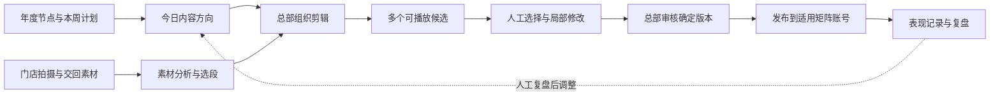

# AHB 产品设计

更新：2026-10-22。本文说明产品面向谁、为什么做、各环节如何连接，以及当前实现与后续设计的边界。运行方式见 [README](../README.md)。

## 产品定位

**AHB 是面向有实体门店和矩阵账号需求的品牌总部内容运营工作台。**

门店持续产生真实画面，总部负责内容判断、制作、审核和分发。AHB 要让这两端衔接：总部知道手里有哪些可用素材，能够把一个运营意图变成数条可播放、可检查、可修改的方案，再由人决定采用哪条。

项目最初基于星尚工作流经验探索通用 AI 剪辑。当前优先场景已经收敛：以餐饮等门店品牌为起点，先服务总部内容运营；网球场馆等同样有线下服务和账号矩阵的品牌是后续验证方向。基础剪辑能力保持通用，近期功能取舍围绕这条业务链。

预期价值是减少找素材、做初剪、比稿和返工的人工时间，并保留品牌对事实与表达的控制。节省时间、采用质量、持续使用和付费意愿都需要实测，当前没有经客户验证的收益结论。

## 目标人群与职责

| 角色 | 关心的问题 | 预期动作 | 当前覆盖 |
|---|---|---|---|
| 总部内容运营 | 今天发什么？哪些画面够用？如何快速出几版？ | 安排选题、检索素材、出初剪、选片和改片 | 首要验证对象，已有本机工作流 |
| 总部编导/剪辑 | 切点是否正确？节奏与声音是否合适？能否局部修正？ | 对照原片、修改节点、确认成片版本 | 已有节点编辑与剪辑拆解 |
| 门店员工/店长 | 拍到什么值得交回？怎样少填信息、快上传？ | 拍摄真实场景，附必要门店和内容信息 | 目标参与者；独立上传端与门店身份未实现 |
| 内容负责人/品牌审核者 | 是否符合品牌、事实、活动及使用范围？ | 看确定版本，提出修改或确认 | 当前线下处理；无正式审核流 |
| 总部发布人员/受托运营团队 | 哪个版本发哪个账号？发布后如何？ | 人工发布、保留链接、关联表现 | 已有导出与发布记录关联，自动分发未实现 |
| 预算负责人 | 是否减少成本和返工，能否稳定交付？ | 决定试点、采购与交付范围 | 采购角色与预算为待验证假设 |

终端视频的观众是门店消费者；他们的兴趣需要运营团队理解，但不是工作台的直接使用者。采购方、内容使用者、素材提供者也不能混为一个人。

### 适合先试的客户

有多家门店或多个账号；总部已经有内容负责人；能持续取得实拍素材；愿意拿真实选题与现行制作方式比较。餐饮先验证菜品制作、门店场景和服务细节，避免同时承担多个内容类型的交付承诺。

尚无稳定素材来源、希望全程无人审核，或主要需要复杂影视后期的客户，暂不作为首批验证对象。首批客户规模、门店数与预算没有预设为已确认条件。

### 与食亨代运营的关系

用户希望结合食亨的代运营能力。产品设计据此保留“品牌总部使用”和“受托运营团队使用”两种操作角色；是否由食亨承担某客户的拍摄、策划、审核、发布或经营复盘，需逐项确认。

交付模式可以在品牌内部工具、服务团队生产工具和软件加服务之间验证。本文不把其中一种写成已定商业模式，也不假设已有覆盖全部环节的团队、报价或平台权限。

## 要解决的工作问题

以下是当前设计假设，应在真实任务中验证：

| 现有工作中的阻力 | AHB 的处理方式 | 需要看到的结果 |
|---|---|---|
| 群聊或文件夹中素材分散，重复翻找 | 上传后形成缩略图、标签、内容和可用区间 | 总部更快找到支撑选题的画面 |
| 一句想法难以直接变成剪辑 | 意图转成有来源区间、速度和声音参数的时间线 | 能输出实际视频，不能只交付文案 |
| 多个方案只是换标题、字幕或模板 | 从取材、次序、时长和节奏形成候选差异 | 人能看出差别并有理由选择 |
| 不知道 AI 改了什么，返工只能重做 | 节点对照原片、处理后片段及已保存决策 | 能定位问题并只改必要片段 |
| 矩阵发布容易混淆版本与账号 | 以确切成片版本关联发布记录 | 复盘时知道哪条视频实际发了出去 |
| 为了优化表现，逐渐只剩一种剪法 | 保留探索方案、轻量相似度降权、人最终选择 | 留下可用的不同表达，避免机械复制 |

不把“2–4秒必须切镜”“每条必须有钩子”等通用说法当作已验证的生理规律或硬规则。叙事、动作展示、运动转场和节奏混剪应分别观察；一个文案段可以覆盖多个镜头。

## 目标业务链与当前边界

这张图描述业务闭环。当前软件覆盖运营计划、素材分析、制作与比较、版本保存和部分表现关联；门店交片由现有渠道完成后在本机导入，审核与发布由人在线下或平台端完成。关联数据已经可以留存，但没有自动更新评分器、训练模型或无人循环改片。

矩阵需求意味着同一主题可能面向不同门店、受众和账号。设计方向是复用真实素材和内容资产，并按适用条件制作差异版本；不能因为生成了3–5条候选就直接将它们全部发布到不同账号。**创意候选比较与账号分发版本是两件事**，当前还没有完整的矩阵适配流程。

### 示例：隆莱呷卤肉饭

以午餐场景为例，运营人员从本周计划选择一个内容方向，使用门店交回的浇卤、装盘、打包与取餐画面：

1. 先检查可用素材、食物是否清晰、动作是否完整、原声是否可用。
2. 给出不同表达，例如动作过程、成品细节、取餐场景；前提是素材能支撑，不能自动补造不存在的镜头。
3. 生成可播放版本，运营人员对照节点确认切点、节奏和声音，修改后再输出。
4. 品牌负责人核对菜品、价格、活动期限及门店适用性；当前审核在工作台之外完成。
5. 发布人员使用确定版本人工发布，再将平台记录与成片对应，后续按同平台、账号和观测条件复盘。

隆莱呷是目前原型的示例品牌，不代表客户签约、官方活动计划或真实经营效果。此例中的选题是场景演示，不构成品牌发布建议。

## 信息架构与功能取舍

| 工作面 | 在业务中的作用 | 近期取舍 |
|---|---|---|
| 运营首页 | 回答近期做什么、今天发什么 | 保留年度节点、周/月计划、今日选题和近期风向；先不做任务单 |
| 素材&分析 | 回答手里有什么、能用哪一段 | 优先保证真实预览、自动分析、可检索内容与片段选取 |
| 开始剪辑 | 把运营意图变成可播放方案 | 优先保证剪辑质量、局部可改、候选可比较 |
| 样片分析 | 学习结构、运镜衔接和声音节奏 | 作为制作辅助，不能让样片原片混入门店素材 |
| 素材生成 | 补充确实缺少的画面或动态图形 | 保留H3和HTML动画，近期不围绕模板数量扩张 |
| 工作空间 | 查看本机做过什么、各版差异是什么 | 按业务项目归档，只读查看剪辑作品与拆解；不承担历史数据看板 |
| 历史数据分析 | 查看发布表现并关联确定版本 | 各项目、平台独立解释口径；先复盘，暂不训练模型 |

### 运营首页

首页面向运营判断，制作桌面位于“开始剪辑”。年度计划覆盖春节营业与返工、开学、暑期、节假日客流及适用的平台营销季；月周计划再落实到内容方向。不能把全年计划写成一串零碎镜头，也不能替品牌确定活动日期或优惠。

近期风向关注平台上可用的话题、拍法与人群场景，保留原始标题、来源和采集时间。当前只保留公开抖音综合榜筛选线索；没有合适结果可以为空。小红书与官方垂类榜的账号接入暂缓，不能把现有线索标成全量或实时垂类趋势。

新生成的选题不能覆盖人工修改和已有排期。选题带来源快照与版本进入制作；当前尚没有品牌级素材权限或全流程适用范围校验。

### 素材与样片

素材页采用紧凑工具栏、可容纳缩略图堆叠的日期日历和当日信息卡；日期指本机上传日期，不应误称拍摄日期。详情展示媒体、标签、摘要、可用片段和转写，未分析不补造内容。

样片采用按文件名管理的横卡，可重命名。叙事片展示章节与语义段，运动衔接展示连续场景与两侧依据，节奏型展示时间关系；无法确定时保持中性镜头序列。镜头检测、文案段与声音判断分别留存，不能用大量0.x秒切镜代替内容结构。

### 剪辑、比较与修改

素材可拖入镜头、替换、插入和排序；节点可打开自然语言要求与手动参数。画布必须服务于看懂和修改视频，不能成为必须学习的复杂流程搭建器。

一批可生成3–5条预览，全部成功后由人选择，也允许全部不采用。共享节点只表达实际播放内容一致的连续开头；没有共同开头就展示不同分支，不能为图形整齐强造一条主轴。

采用方案表示“选它继续制作”，**不表示品牌审核通过**。剪辑拆解读取已保存方案与渲染记录，展示真实取材区间、速度、音量及处理结果；不在查看时临时生成解释。人仍需判断画面是否正确、表达是否成立。

### 生成素材

生成页先完整显示九个紧凑模板卡片，再在页面内展开工作区；左侧描述及可编辑分镜，右侧对应预览。输入提示是需求示例，不能冒充模板样片的官方原始提示词。

先生成方案，再逐段确认；H3整批生成前显示预计费用。仅修改一段时复用其他已完成片段，拼接另存新版本。未知回执查询原任务，不能自动重复提交。HTML动画通过源码渲染形成素材，再进入同一剪辑流程；它不是操作剪辑软件的Computer Use能力。

## AI 与程序各自负责什么

DeepSeek负责基于证据提出观察、取舍和结构化决策；程序负责范围、时间、文件与执行一致性。证据不足时保留不确定，不能靠流畅文案把猜测变成事实。产品不能依赖开发者逐片代替DS填正确答案。

视频与源片段的入出点、速度和成片帧边界必须能对应。动作剪辑用观察动作的索引引用源区间，按速度推导时长；编译后保存实际帧边界。保留文件指纹、计划和执行参数用于回放，不承诺跨机器字体与编码环境下逐字节一致。

当前菜品路径支持0.5–2倍恒定速度、原声保持音高、分段音量、配乐退让与有限的音乐事件对齐；没有镜内速度曲线或自动声效设计。声音事件来自本机测量，音乐起音不等于已确认强拍，DS也没有直接听原音。

### 上下文与复用

不同阶段只接收需要的素材、证据与当前要求，保留请求指纹、版本及原始回执。已有成功观察和片段结果尽量复用；失败只重做必要部分，旧结果不能覆盖期间的新修改。当前请求封装提供稳定结构和预算检查，并不是已经完成的通用自主Agent运行系统。

本地缓存命中意味着不再发起该阶段请求；供应商缓存命中只按回执记录。两者不混为一个节省数字。使用量按作品、素材和任务保留，失败尝试也应计入实际成本。

## 数据与对象边界

| 对象 | 含义 | 必须保留的关系 |
|---|---|---|
| 业务项目 | 组织本机作品与历史记录的分组 | 当前不是企业租户或权限边界 |
| 素材 / 样片 | 用于制作的资产 / 用于理解的参考视频 | 用途分离，原件与指纹保留 |
| 分析版本 | 某组证据上的观察结果 | 源素材、证据时间、模型与版本 |
| 选题 | 运营计划中的内容方向 | 日期、平台、来源快照及修改版本 |
| 制作项目 / 方案 | 一次创作及其多次剪法 | 选中素材、父方案、修改来源 |
| 候选批次 / 选择事件 | 同一需求下的比较与人的选择 | 展示、查看、采用或放弃、可选理由 |
| 渲染成片 | 确切执行结果 | 方案ID、素材指纹、输出指纹、实际时间线 |
| 发布记录 / 观测 | 平台视频及多次采集 | 平台、账号、发布时间、采集时间、指标口径 |
| 发布绑定 | 人确认平台视频对应哪份本机成片 | 确切render与SHA，撤销保留历史 |

历史数据按平台分别展示。累计播放不是日新增；采集次数不是视频数；缺失不补零。时长、账号规模、投流与观测时间不同，不能直接把指标差异归因于某个切点。转化与经营结果需要另外的数据来源及归因设计，目前没有接通。

门店、账号适用范围、企业身份、正式审批记录与访问权限是产品化所需的新对象或约束，不能由现有业务项目名冒充。

## 抗趋同与数据使用

当前采用三个原则：

1. **保留探索方案。** 每批1条在取材、顺序或时长分配上明显不同，并通过同样的素材与输出检查。没有评分模型，不能把它描述为“违背模型最优解”。
2. **轻量限制历史重复。** 对有可比历史的本机已采用成片计算结构相似度，最多扣0.08排序分；没有历史时留空。它是工程启发式，不是播放或审美预测。
3. **人最终选择。** 排序不能替人采用，探索片不能因低排名自动消失。人的选择与观众表现分别留存。

当前并未将星尚的历史发布表现自动喂给剪辑模型。数据首先用来复盘具体版本、保留选择与修改证据；是否训练、用什么指标、样本是否足够，需要后续单独验证。早期调研文档中的固定镜长、自动更新打分器等设想，不自动成为实现要求。

## 企业化需要补齐的环节

以下是设计方向，尚未开发，也没有承诺交付日期。

| 环节 | 角色与经营动作 | 输入、更新与异常处理 | 完成条件 |
|---|---|---|---|
| 门店素材接收 | 门店上传，总部接收 | 拍摄来源、门店与必要说明随批次进入；上传失败可重试，不丢原件 | 门店可独立交片，总部能找到正确来源，身份和可见范围有效 |
| 品牌内容约束 | 品牌负责人维护，运营使用 | 菜品、活动、价格与适用门店在变更时更新；过期或不明确时要求核对 | 制作与审核能看到所用事实版本，不借用其他门店信息 |
| 正式审核 | 品牌负责人对确定成片做决定 | 针对render记录意见和确认；成片变化后需再次确认 | 确认记录无法错误套用到新版本，修改意见可追溯 |
| 矩阵分发 | 授权发布人员执行 | 明确账号、素材/活动适用范围、确定版本与排期；未知结果先查询 | 账号与成片一一对应，失败不重复发布，权限受控 |
| 持续复盘 | 内容运营及数据维护者共同解释 | 按可取得的数据周期更新；保留采集时刻、缺失和口径 | 能追溯某版的实际表现，不把相关性写成提效或转化因果 |

真实登录、团队权限、企业数据隔离、服务部署、账号授权、订阅与支付需要作为产品化工作处理。当前本机版本不具备这些条件；“给企业内部用”的意图不等于已经是可直接上线的企业系统。

## 验证收益

近期先用一条真实制作链路验证质量和使用价值，再决定扩展功能。技术验证已有蛋包饭试片，下一步应取得品牌实际任务及可用素材，记录现行人工流程作为比较基线；不预先写“节省80%”或“每天百条”。

| 维度 | 记录方式 | 判断重点 |
|---|---|---|
| 人工制作负担 | 同类任务记录找素材、初剪、改片的人工时间，另记模型等待与渲染时间 | 是否减少真实操作，而不是将时间转移到反复纠错 |
| 初稿采用 | 记录每批候选被采用、全部放弃及主要原因 | 是否有总部愿意继续改的版本，差异是否有意义 |
| 修改成本 | 留存修改轮次、修改类型、局部重做和返工原因 | 能否准确修一处，不破坏其他已确认内容 |
| 内容质量 | 人工看画面、动作完整性、声音、字幕和品牌事实 | 程序检查通过不能替代审片 |
| 实际成本 | 供应商回执、失败重试、机器耗时与必要人工 | 按可用成片统计，开发联调成本单列 |
| 版本与发布 | 记录确定成片、发布链接、账号和匹配确认 | 能否可靠复盘，是否发生错版或错账号 |
| 持续使用与采购 | 观察真实周期内是否继续用，访谈实际预算负责人 | 是否解决持续需求，而非只认可演示 |

播放、互动、完播率仅在同平台、相近账号与内容条件下谨慎比较；有数据才记录。缺少完播率、转化或自然/投流区分时，明确留空，不从播放量补推。

试点周期、可接受的修改量、质量门槛、响应时间、成本上限和负责人，应与试点客户确定后再作为验收门槛。当前这些值尚未约定。

## 交互与视觉原则

白色为主，重点蓝 `#243BEB`；正文 `#242833`，次要文字 `#69717E`，浅灰 `#F6F7F9`。中文使用系统中文字体，时间与秒数使用等宽数字。视频和素材是视觉主体，蓝色标明操作、选中与重点。

运营首页先呈现时间与内容；素材页先呈现画面；创作页先呈现片段和可播放方案。只在用量和结构胶囊等局部使用轻浮雕。缩略图、输入、播放器和被编辑节点应在更新中保持身份，不能因异步进度刷新打断播放或丢失输入。

| 交互 | 应保持的对象 | 约束 |
|---|---|---|
| 日历切换、素材详情返回 | 日期、素材ID、筛选和滚动位置 | 上传日期口径一致，空日期不伪造内容 |
| 拖拽或编辑镜头 | 分支ID、镜头ID、草稿与预览 | 有目标反馈、取消回位和撤销；旧AI结果不能覆盖新输入 |
| 候选生成与切换 | 批次、方案、渲染版本 | 已在播放的预览不被进度刷新重建 |
| 样片节点与证据定位 | 同一个原视频播放器 | 不把内容段、切镜和语义段混成一个单位 |
| 模板展开及分段修改 | 模板草稿、片段与确认版本 | 页面内展开；修改后取消旧确认，提示词同步后再生成 |
| 用量明细与版本查看 | 作用域、回执与成片版本 | 缺失不补造，重试不隐藏，旧记录可回看 |

支持按钮完成关键拖拽操作；减少动态偏好下直接到达状态。用户界面不出现内部接口、密钥配置、虚构订阅状态或开发者说明。文档中的技术说明留在文档，不搬进用户流程充当引导。

## 当前实现与后续判断

现有实现使用 FastAPI、SQLite 和原生网页界面；模型调用与本机媒体处理分开。代码位置见 [README 的代码入口](../README.md#代码入口)，第三方生成规范及来源见 [Skill 适配说明](../vendor/skills/README.md)。

近期优先：验证门店实拍的可用选段、节奏与声音，再让总部用真实选题比较和修改。取得使用与收益证据后，依次判断门店接收、品牌约束、审核和分发的必要范围。避免继续用UI细修、模板扩充或模型训练，代替对真实制作任务的验证。

业务定位以用户已确认的总部场景为准；角色中的采购假设、企业化流程及验收门槛是本文提出的待验证设计。实现状态以代码和实际验收记录为准，本文不将产品愿景当作已上线能力。
